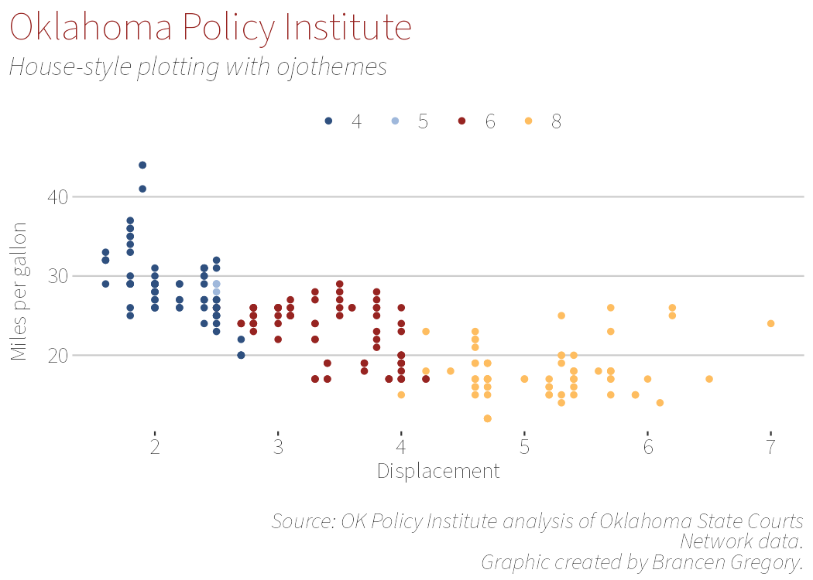

<!-- README.md is generated from README.Rmd. Please edit that file -->

# ojothemes

<!-- badges: start -->

[](https://lifecycle.r-lib.org/articles/stages.html#stable)
[](https://openjusticeok.github.io/ojothemes/)
<!-- badges: end -->

`ojothemes` contains [ggplot2](https://ggplot2.tidyverse.org/) and
[gt](https://gt.rstudio.com/) themes for the Oklahoma Policy Institute
(OPI) and Together Oklahoma (TOK) house styles, along with tools for
fonts and plot export that make graphics reproducible on every machine.

## Installation

``` r
# install.packages("pak")
pak::pak("openjusticeok/ojothemes")
```

## Fonts

Source Sans 3 ships inside the package (variable font, SIL OFL) and is
registered with `systemfonts` at load time — no font installation, admin
rights, or network access needed. Every theme defaults to it, so plots
render **pixel-identically** on Windows, macOS, and Linux.

Proprietary fonts (e.g., Adobe Myriad Pro) are supported through a
`fonts/` drop-in folder in your project; see `ojo_fonts()` and the
vignette.

## Example

``` r
library(ojothemes)
library(ggplot2)
#> 
#> Attaching package: 'ggplot2'
#> The following objects are masked from 'package:ojothemes':
#> 
#>     geom_bar, geom_col, geom_jitter, geom_line, geom_path, geom_point,
#>     geom_step, geom_text

p <- ggplot(mpg, aes(x = displ, y = hwy, colour = factor(cyl))) +
  geom_point() +
  ojo_labs(
    analyst_name = "Brancen Gregory",
    source = "oscn",
    title = "Oklahoma Policy Institute",
    subtitle = "House-style plotting with ojothemes",
    x = "Displacement",
    y = "Miles per gallon"
  ) +
  theme_opi()

p
```



Styled tables work the same way with `gt`:

``` r
library(gt)
gt_opi(mpg[1:6, 1:6])
```

<div id="gdpruqourw" style="padding-left:0px;padding-right:0px;padding-top:10px;padding-bottom:10px;overflow-x:auto;overflow-y:auto;width:auto;height:auto;">
<style>#gdpruqourw table {
  font-family: 'Source Sans 3', system-ui, 'Segoe UI', Roboto, Helvetica, Arial, sans-serif, 'Apple Color Emoji', 'Segoe UI Emoji', 'Segoe UI Symbol', 'Noto Color Emoji';
  -webkit-font-smoothing: antialiased;
  -moz-osx-font-smoothing: grayscale;
}
&#10;#gdpruqourw thead, #gdpruqourw tbody, #gdpruqourw tfoot, #gdpruqourw tr, #gdpruqourw td, #gdpruqourw th {
  border-style: none;
}
&#10;#gdpruqourw p {
  margin: 0;
  padding: 0;
}
&#10;#gdpruqourw .gt_table {
  display: table;
  border-collapse: collapse;
  line-height: normal;
  margin-left: auto;
  margin-right: auto;
  color: #333333;
  font-size: medium;
  font-weight: normal;
  font-style: normal;
  background-color: #FFFFFF;
  width: auto;
  border-top-style: none;
  border-top-width: 2px;
  border-top-color: #A8A8A8;
  border-right-style: none;
  border-right-width: 2px;
  border-right-color: #D3D3D3;
  border-bottom-style: none;
  border-bottom-width: 2px;
  border-bottom-color: #A8A8A8;
  border-left-style: none;
  border-left-width: 2px;
  border-left-color: #D3D3D3;
}
&#10;#gdpruqourw .gt_caption {
  padding-top: 4px;
  padding-bottom: 4px;
}
&#10;#gdpruqourw .gt_title {
  color: #333333;
  font-size: medium;
  font-weight: initial;
  padding-top: 4px;
  padding-bottom: 4px;
  padding-left: 5px;
  padding-right: 5px;
  border-bottom-color: #FFFFFF;
  border-bottom-width: 0;
}
&#10;#gdpruqourw .gt_subtitle {
  color: #333333;
  font-size: small;
  font-weight: initial;
  padding-top: 3px;
  padding-bottom: 5px;
  padding-left: 5px;
  padding-right: 5px;
  border-top-color: #FFFFFF;
  border-top-width: 0;
}
&#10;#gdpruqourw .gt_heading {
  background-color: #FFFFFF;
  text-align: left;
  border-bottom-color: #FFFFFF;
  border-left-style: none;
  border-left-width: 1px;
  border-left-color: #D3D3D3;
  border-right-style: none;
  border-right-width: 1px;
  border-right-color: #D3D3D3;
}
&#10;#gdpruqourw .gt_bottom_border {
  border-bottom-style: none;
  border-bottom-width: 2px;
  border-bottom-color: #D3D3D3;
}
&#10;#gdpruqourw .gt_col_headings {
  border-top-style: none;
  border-top-width: 2px;
  border-top-color: #D3D3D3;
  border-bottom-style: solid;
  border-bottom-width: 3px;
  border-bottom-color: #D3D3D3;
  border-left-style: none;
  border-left-width: 1px;
  border-left-color: #D3D3D3;
  border-right-style: none;
  border-right-width: 1px;
  border-right-color: #D3D3D3;
}
&#10;#gdpruqourw .gt_col_heading {
  color: #333333;
  background-color: #FFFFFF;
  font-size: medium;
  font-weight: normal;
  text-transform: inherit;
  border-left-style: none;
  border-left-width: 1px;
  border-left-color: #D3D3D3;
  border-right-style: none;
  border-right-width: 1px;
  border-right-color: #D3D3D3;
  vertical-align: bottom;
  padding-top: 5px;
  padding-bottom: 6px;
  padding-left: 5px;
  padding-right: 5px;
  overflow-x: hidden;
}
&#10;#gdpruqourw .gt_column_spanner_outer {
  color: #333333;
  background-color: #FFFFFF;
  font-size: medium;
  font-weight: normal;
  text-transform: inherit;
  padding-top: 0;
  padding-bottom: 0;
  padding-left: 4px;
  padding-right: 4px;
}
&#10;#gdpruqourw .gt_column_spanner_outer:first-child {
  padding-left: 0;
}
&#10;#gdpruqourw .gt_column_spanner_outer:last-child {
  padding-right: 0;
}
&#10;#gdpruqourw .gt_column_spanner {
  border-bottom-style: solid;
  border-bottom-width: 3px;
  border-bottom-color: #D3D3D3;
  vertical-align: bottom;
  padding-top: 5px;
  padding-bottom: 5px;
  overflow-x: hidden;
  display: inline-block;
  width: 100%;
}
&#10;#gdpruqourw .gt_spanner_row {
  border-bottom-style: hidden;
}
&#10;#gdpruqourw .gt_group_heading {
  padding-top: 8px;
  padding-bottom: 8px;
  padding-left: 5px;
  padding-right: 5px;
  color: #333333;
  background-color: #FFFFFF;
  font-size: 100%;
  font-weight: initial;
  text-transform: inherit;
  border-top-style: solid;
  border-top-width: 2px;
  border-top-color: #D3D3D3;
  border-bottom-style: solid;
  border-bottom-width: 2px;
  border-bottom-color: #D3D3D3;
  border-left-style: none;
  border-left-width: 1px;
  border-left-color: #D3D3D3;
  border-right-style: none;
  border-right-width: 1px;
  border-right-color: #D3D3D3;
  vertical-align: middle;
  text-align: left;
}
&#10;#gdpruqourw .gt_empty_group_heading {
  padding: 0.5px;
  color: #333333;
  background-color: #FFFFFF;
  font-size: 100%;
  font-weight: initial;
  border-top-style: solid;
  border-top-width: 2px;
  border-top-color: #D3D3D3;
  border-bottom-style: solid;
  border-bottom-width: 2px;
  border-bottom-color: #D3D3D3;
  vertical-align: middle;
}
&#10;#gdpruqourw .gt_from_md > :first-child {
  margin-top: 0;
}
&#10;#gdpruqourw .gt_from_md > :last-child {
  margin-bottom: 0;
}
&#10;#gdpruqourw .gt_row {
  padding-top: 7px;
  padding-bottom: 7px;
  padding-left: 5px;
  padding-right: 5px;
  margin: 10px;
  border-top-style: solid;
  border-top-width: 1px;
  border-top-color: #D3D3D3;
  border-left-style: none;
  border-left-width: 1px;
  border-left-color: #D3D3D3;
  border-right-style: none;
  border-right-width: 1px;
  border-right-color: #D3D3D3;
  vertical-align: middle;
  overflow-x: hidden;
}
&#10;#gdpruqourw .gt_stub {
  color: #333333;
  background-color: #FFFFFF;
  font-size: 100%;
  font-weight: initial;
  text-transform: inherit;
  border-right-style: solid;
  border-right-width: 2px;
  border-right-color: #D3D3D3;
  padding-left: 5px;
  padding-right: 5px;
}
&#10;#gdpruqourw .gt_stub_row_group {
  color: #333333;
  background-color: #FFFFFF;
  font-size: 100%;
  font-weight: initial;
  text-transform: inherit;
  border-right-style: solid;
  border-right-width: 2px;
  border-right-color: #D3D3D3;
  padding-left: 5px;
  padding-right: 5px;
  vertical-align: top;
}
&#10;#gdpruqourw .gt_row_group_first td {
  border-top-width: 2px;
}
&#10;#gdpruqourw .gt_row_group_first th {
  border-top-width: 2px;
}
&#10;#gdpruqourw .gt_summary_row {
  color: #333333;
  background-color: #FFFFFF;
  text-transform: inherit;
  padding-top: 8px;
  padding-bottom: 8px;
  padding-left: 5px;
  padding-right: 5px;
}
&#10;#gdpruqourw .gt_first_summary_row {
  border-top-style: solid;
  border-top-color: #D3D3D3;
}
&#10;#gdpruqourw .gt_first_summary_row.thick {
  border-top-width: 2px;
}
&#10;#gdpruqourw .gt_last_summary_row {
  padding-top: 8px;
  padding-bottom: 8px;
  padding-left: 5px;
  padding-right: 5px;
  border-bottom-style: solid;
  border-bottom-width: 2px;
  border-bottom-color: #D3D3D3;
}
&#10;#gdpruqourw .gt_grand_summary_row {
  color: #333333;
  background-color: #FFFFFF;
  text-transform: inherit;
  padding-top: 8px;
  padding-bottom: 8px;
  padding-left: 5px;
  padding-right: 5px;
}
&#10;#gdpruqourw .gt_first_grand_summary_row {
  padding-top: 8px;
  padding-bottom: 8px;
  padding-left: 5px;
  padding-right: 5px;
  border-top-style: double;
  border-top-width: 6px;
  border-top-color: #D3D3D3;
}
&#10;#gdpruqourw .gt_last_grand_summary_row_top {
  padding-top: 8px;
  padding-bottom: 8px;
  padding-left: 5px;
  padding-right: 5px;
  border-bottom-style: double;
  border-bottom-width: 6px;
  border-bottom-color: #D3D3D3;
}
&#10;#gdpruqourw .gt_striped {
  background-color: rgba(128, 128, 128, 0.05);
}
&#10;#gdpruqourw .gt_table_body {
  border-top-style: solid;
  border-top-width: 2px;
  border-top-color: #D3D3D3;
  border-bottom-style: solid;
  border-bottom-width: 2px;
  border-bottom-color: #D3D3D3;
}
&#10;#gdpruqourw .gt_footnotes {
  color: #333333;
  background-color: #FFFFFF;
  border-bottom-style: none;
  border-bottom-width: 2px;
  border-bottom-color: #D3D3D3;
  border-left-style: none;
  border-left-width: 2px;
  border-left-color: #D3D3D3;
  border-right-style: none;
  border-right-width: 2px;
  border-right-color: #D3D3D3;
}
&#10;#gdpruqourw .gt_footnote {
  margin: 0px;
  font-size: 90%;
  padding-top: 4px;
  padding-bottom: 4px;
  padding-left: 5px;
  padding-right: 5px;
}
&#10;#gdpruqourw .gt_sourcenotes {
  color: #333333;
  background-color: #FFFFFF;
  border-bottom-style: none;
  border-bottom-width: 2px;
  border-bottom-color: #D3D3D3;
  border-left-style: none;
  border-left-width: 2px;
  border-left-color: #D3D3D3;
  border-right-style: none;
  border-right-width: 2px;
  border-right-color: #D3D3D3;
}
&#10;#gdpruqourw .gt_sourcenote {
  font-size: 90%;
  padding-top: 4px;
  padding-bottom: 4px;
  padding-left: 5px;
  padding-right: 5px;
}
&#10;#gdpruqourw .gt_left {
  text-align: left;
}
&#10;#gdpruqourw .gt_center {
  text-align: center;
}
&#10;#gdpruqourw .gt_right {
  text-align: right;
  font-variant-numeric: tabular-nums;
}
&#10;#gdpruqourw .gt_font_normal {
  font-weight: normal;
}
&#10;#gdpruqourw .gt_font_bold {
  font-weight: bold;
}
&#10;#gdpruqourw .gt_font_italic {
  font-style: italic;
}
&#10;#gdpruqourw .gt_super {
  font-size: 65%;
}
&#10;#gdpruqourw .gt_footnote_marks {
  font-size: 75%;
  vertical-align: 0.4em;
  position: initial;
}
&#10;#gdpruqourw .gt_asterisk {
  font-size: 100%;
  vertical-align: 0;
}
&#10;#gdpruqourw .gt_indent_1 {
  text-indent: 5px;
}
&#10;#gdpruqourw .gt_indent_2 {
  text-indent: 10px;
}
&#10;#gdpruqourw .gt_indent_3 {
  text-indent: 15px;
}
&#10;#gdpruqourw .gt_indent_4 {
  text-indent: 20px;
}
&#10;#gdpruqourw .gt_indent_5 {
  text-indent: 25px;
}
&#10;#gdpruqourw .katex-display {
  display: inline-flex !important;
  margin-bottom: 0.75em !important;
}
&#10;#gdpruqourw div.Reactable > div.rt-table > div.rt-thead > div.rt-tr.rt-tr-group-header > div.rt-th-group:after {
  height: 0px !important;
}
</style>
<table class="gt_table" data-quarto-disable-processing="false" data-quarto-bootstrap="false">
  <thead>
    <tr class="gt_col_headings">
      <th class="gt_col_heading gt_columns_bottom_border gt_left" rowspan="1" colspan="1" style="color: #333333; font-weight: bold; text-transform: uppercase;" scope="col" id="manufacturer">Manufacturer</th>
      <th class="gt_col_heading gt_columns_bottom_border gt_left" rowspan="1" colspan="1" style="color: #333333; font-weight: bold; text-transform: uppercase;" scope="col" id="model">Model</th>
      <th class="gt_col_heading gt_columns_bottom_border gt_right" rowspan="1" colspan="1" style="color: #333333; font-weight: bold; text-transform: uppercase;" scope="col" id="displ">Displ</th>
      <th class="gt_col_heading gt_columns_bottom_border gt_right" rowspan="1" colspan="1" style="color: #333333; font-weight: bold; text-transform: uppercase;" scope="col" id="year">Year</th>
      <th class="gt_col_heading gt_columns_bottom_border gt_right" rowspan="1" colspan="1" style="color: #333333; font-weight: bold; text-transform: uppercase;" scope="col" id="cyl">Cyl</th>
      <th class="gt_col_heading gt_columns_bottom_border gt_left" rowspan="1" colspan="1" style="color: #333333; font-weight: bold; text-transform: uppercase;" scope="col" id="trans">Trans</th>
    </tr>
  </thead>
  <tbody class="gt_table_body">
    <tr><td headers="manufacturer" class="gt_row gt_left">audi</td>
<td headers="model" class="gt_row gt_left">a4</td>
<td headers="displ" class="gt_row gt_right">1.8</td>
<td headers="year" class="gt_row gt_right">1,999 </td>
<td headers="cyl" class="gt_row gt_right">4 </td>
<td headers="trans" class="gt_row gt_left">auto(l5)</td></tr>
    <tr><td headers="manufacturer" class="gt_row gt_left">audi</td>
<td headers="model" class="gt_row gt_left">a4</td>
<td headers="displ" class="gt_row gt_right">1.8</td>
<td headers="year" class="gt_row gt_right">1,999 </td>
<td headers="cyl" class="gt_row gt_right">4 </td>
<td headers="trans" class="gt_row gt_left">manual(m5)</td></tr>
    <tr><td headers="manufacturer" class="gt_row gt_left">audi</td>
<td headers="model" class="gt_row gt_left">a4</td>
<td headers="displ" class="gt_row gt_right">2  </td>
<td headers="year" class="gt_row gt_right">2,008 </td>
<td headers="cyl" class="gt_row gt_right">4 </td>
<td headers="trans" class="gt_row gt_left">manual(m6)</td></tr>
    <tr><td headers="manufacturer" class="gt_row gt_left">audi</td>
<td headers="model" class="gt_row gt_left">a4</td>
<td headers="displ" class="gt_row gt_right">2  </td>
<td headers="year" class="gt_row gt_right">2,008 </td>
<td headers="cyl" class="gt_row gt_right">4 </td>
<td headers="trans" class="gt_row gt_left">auto(av)</td></tr>
    <tr><td headers="manufacturer" class="gt_row gt_left">audi</td>
<td headers="model" class="gt_row gt_left">a4</td>
<td headers="displ" class="gt_row gt_right">2.8</td>
<td headers="year" class="gt_row gt_right">1,999 </td>
<td headers="cyl" class="gt_row gt_right">6 </td>
<td headers="trans" class="gt_row gt_left">auto(l5)</td></tr>
    <tr><td headers="manufacturer" class="gt_row gt_left">audi</td>
<td headers="model" class="gt_row gt_left">a4</td>
<td headers="displ" class="gt_row gt_right">2.8</td>
<td headers="year" class="gt_row gt_right">1,999 </td>
<td headers="cyl" class="gt_row gt_right">6 </td>
<td headers="trans" class="gt_row gt_left">manual(m5)</td></tr>
  </tbody>
  &#10;</table>
</div>

## Exporting

``` r
# Pass communications specs verbatim, in any unit
ojo_save_png(p, "plot.png", width = 1080, height = 675, unit = "px", dpi = 144)
ojo_save_svg(p, "plot.svg", width = 178, height = 127, unit = "mm")
```
