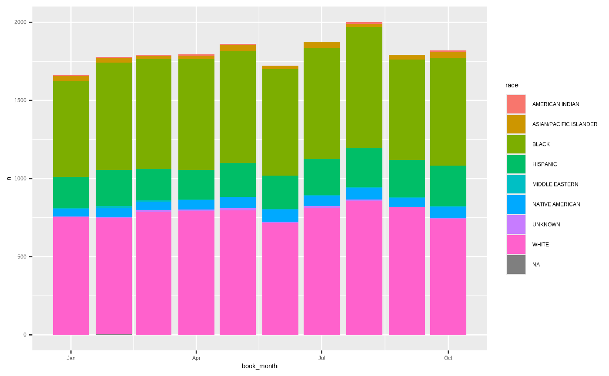
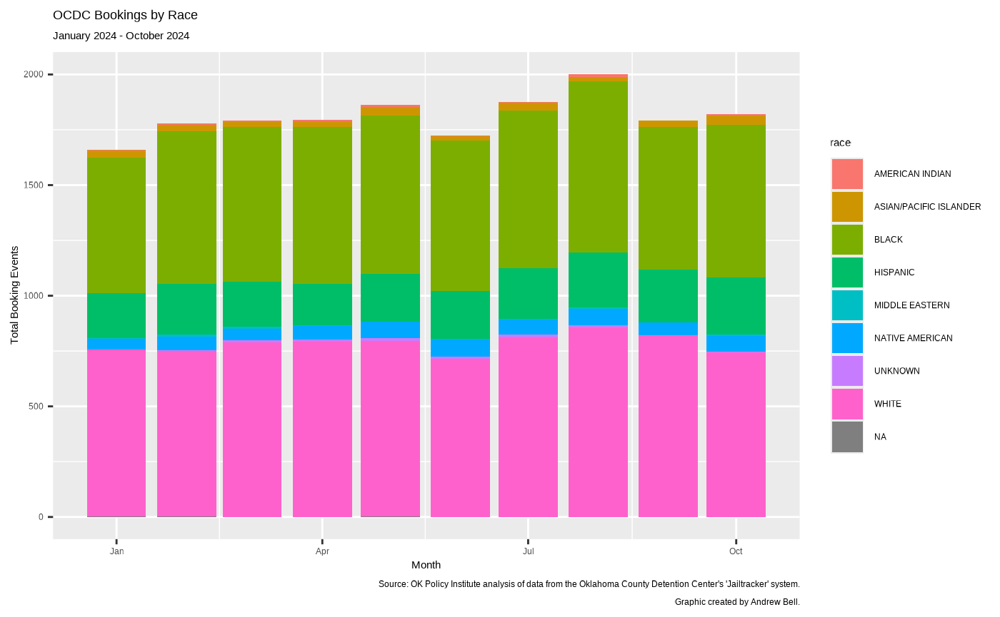
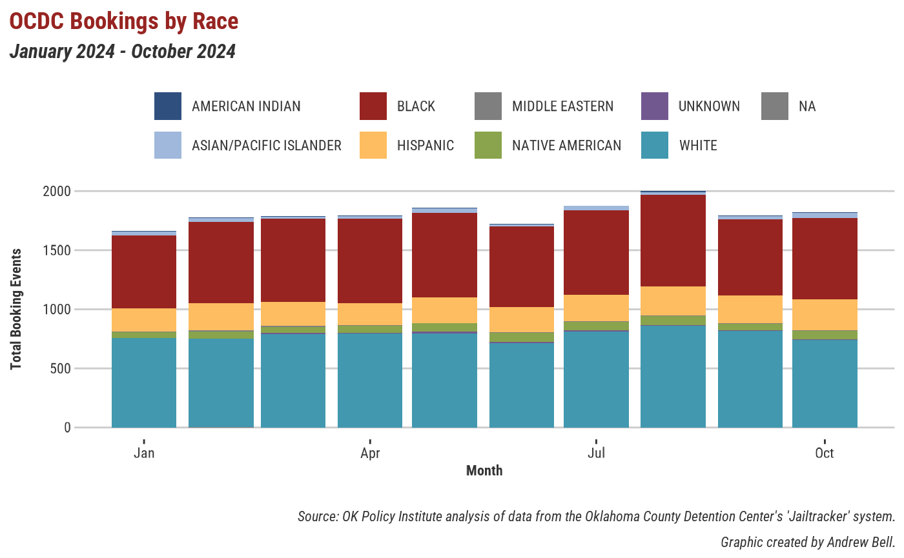
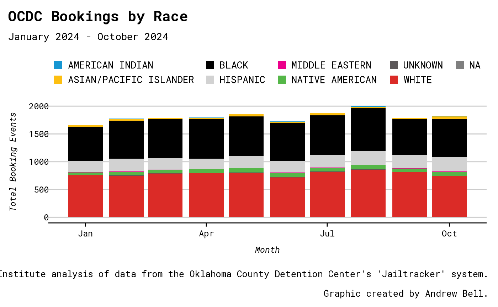

# ojoThemes Guide

This guide will walk you through the themes and tools available in the
`ojoThemes` package. We’ll start by loading the package (plus
`tidyverse` and `ojodb` for some test data), then we’ll make some
example graphs and tables to show you what’s available.

``` r

library(ojothemes)
#> Setting Mac/Linux options...
library(ojodb)
#> Loading required package: dplyr
#> 
#> Attaching package: 'dplyr'
#> The following objects are masked from 'package:stats':
#> 
#>     filter, lag
#> The following objects are masked from 'package:base':
#> 
#>     intersect, setdiff, setequal, union
library(dplyr)
library(ggplot2)
#> 
#> Attaching package: 'ggplot2'
#> The following objects are masked from 'package:ojothemes':
#> 
#>     geom_bar, geom_col, geom_jitter, geom_line, geom_path, geom_point,
#>     geom_step, geom_text
library(lubridate)
#> 
#> Attaching package: 'lubridate'
#> The following objects are masked from 'package:base':
#> 
#>     date, intersect, setdiff, union
library(gt)

# Test data from OCDC
data <- ojo_tbl(
  schema = "ocdc",
  table = "arrest"
) |>
  filter(
    book_date >= "01-01-2024",
    book_date < "11-01-2024"
  ) |>
  ojo_collect()
#> ℹ Creating a new default connection to the OJO database.
#> • This connection will be closed automatically when your R session ends.
#> This message is displayed once per session.
```

## Themes for `ggplot` graphs

First, let’s see how this data looks on a default ggplot:

``` r

p1 <- data |>
  # We'll look at the bookings by race here,
  # and we'll look by month just to make it easier to see.
  count(
    book_month = floor_date(book_date, "months"),
    race
  ) |>
  ggplot(aes(x = book_month, y = n, fill = race)) +
  geom_col()

p1
```



Next, let’s gussy this up with our `ojoThemes` tools. First, let’s use
the
[`ojothemes::ojo_labs()`](https://openjusticeok.github.io/ojothemes/reference/ojo_labs.md)
function to easily add a nice caption to the plot:

``` r

p1 <- p1 +
  ojo_labs(
    analyst_name = "Andrew Bell",
    source = "ocdc",
    title = "OCDC Bookings by Race",
    subtitle = "January 2024 - October 2024",
    x = "Month",
    y = "Total Booking Events"
  )

p1
```



This is just a wrapper for the normal
[`ggplot2::labs()`](https://ggplot2.tidyverse.org/reference/labs.html)
function, so we can pass arguments like `title`, `subtitle`, `x`, and
`y` to it. The really neat thing, though, is the new `analyst_name` and
`source` arguments. These will add a nice little “Graphic created by…”
caption crediting the analyst, and a consistently phrased note on where
the data came from.

- Right now, you can use `"oscn"`, `"ocdc"`, or `"ppb"` as the `source`
  argument to get a pre-written, consistent source note. However, if
  you’re working with something not in one of those domains, you can
  just tell it something to put in there verbatim,
  e.g. `source = "Source: Data Pulled from The National Insitute of My Ass database"`.

Next, let’s actually apply our themes. There are two ways to do this:
the first is to just throw `+ theme_okpi()` onto our ggplot, like so:

``` r

p1 + theme_okpi()
```



This applies not just the theme / fonts, but the color / fill scales as
well. If you want just the theme without the scales, you can do
`p1 + theme_okpi_base()`.

The second way of applying a theme is by using
[`ojothemes::ojo_set_theme()`](https://openjusticeok.github.io/ojothemes/reference/ojo_set_theme.md).
This is probably going to be the most common way of doing things, since
we’re rarely going to want to use multiple themes in the same script /
document / etc. Let’s try that same graph in the “ojo” theme this time:

``` r

ojo_set_theme(theme = "ojo")

p1
```



## Themes for `gt` tables

This package also has built in themes for tables made with `gt`. You can
use these by replacing the normal
[`gt()`](https://gt.rstudio.com/reference/gt.html) function with one of
our themed wrappers (currently
[`gt_okpi()`](https://openjusticeok.github.io/ojothemes/reference/gt_okpi.md)
and
[`gt_ojo()`](https://openjusticeok.github.io/ojothemes/reference/gt_ojo.md)).
These have built in arguments for customization:

- `source` and `analyst_name` (which work just like the
  [`ojo_labs()`](https://openjusticeok.github.io/ojothemes/reference/ojo_labs.md)
  function for ggplots)
- `title` and `subtitle` (self explanatory)
- `format_cols` (a logical that will apply the auto-styling from `gt` to
  every column if `TRUE`)
- `font` and `font_size` for making really big / small tables.

Here’s what a normal, unstyled table looks like…

``` r

data |>
  count(race) |>
  gt()
```

| race                   | n    |
|------------------------|------|
| AMERICAN INDIAN        | 60   |
| ASIAN/PACIFIC ISLANDER | 292  |
| BLACK                  | 6931 |
| HISPANIC               | 2222 |
| MIDDLE EASTERN         | 53   |
| NATIVE AMERICAN        | 643  |
| UNKNOWN                | 70   |
| WHITE                  | 7826 |
| NA                     | 6    |

…here’s what our
[`gt_okpi()`](https://openjusticeok.github.io/ojothemes/reference/gt_okpi.md)
theme does to it…

``` r

data |>
  count(race) |>
  gt_okpi(
    title = "OCDC Bookings by Race",
    subtitle = "January 2024 - October 2024",
    source = "ocdc",
    analyst_name = "Andrew Bell",
    format_cols = TRUE
  )
```

| OCDC Bookings by Race |  |
|----|----|
| January 2024 - October 2024 |  |
| Race | N |
| AMERICAN INDIAN |    60  |
| ASIAN/PACIFIC ISLANDER |   292  |
| BLACK | 6,931  |
| HISPANIC | 2,222  |
| MIDDLE EASTERN |    53  |
| NATIVE AMERICAN |   643  |
| UNKNOWN |    70  |
| WHITE | 7,826  |
| NA |     6  |
| Source: OK Policy Institute analysis of data from the Oklahoma County Detention Center's 'Jailtracker' system. |  |
| Graphic created by Andrew Bell. |  |

…and finally, here’s
[`gt_ojo()`](https://openjusticeok.github.io/ojothemes/reference/gt_ojo.md):

``` r

data |>
  count(race) |>
  gt_ojo(
    title = "OCDC Bookings by Race",
    subtitle = "January 2024 - October 2024",
    source = "ocdc",
    analyst_name = "Andrew Bell",
    format_cols = TRUE
  )
```

| OCDC Bookings by Race |  |
|----|----|
| January 2024 - October 2024 |  |
| Race | N |
| AMERICAN INDIAN |    60  |
| ASIAN/PACIFIC ISLANDER |   292  |
| BLACK | 6,931  |
| HISPANIC | 2,222  |
| MIDDLE EASTERN |    53  |
| NATIVE AMERICAN |   643  |
| UNKNOWN |    70  |
| WHITE | 7,826  |
| NA |     6  |
| Source: OK Policy Institute analysis of data from the Oklahoma County Detention Center's 'Jailtracker' system. |  |
| Graphic created by Andrew Bell. |  |
